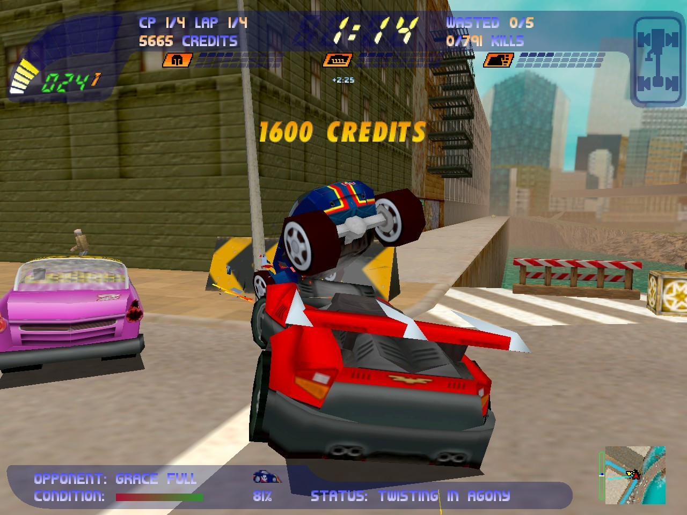
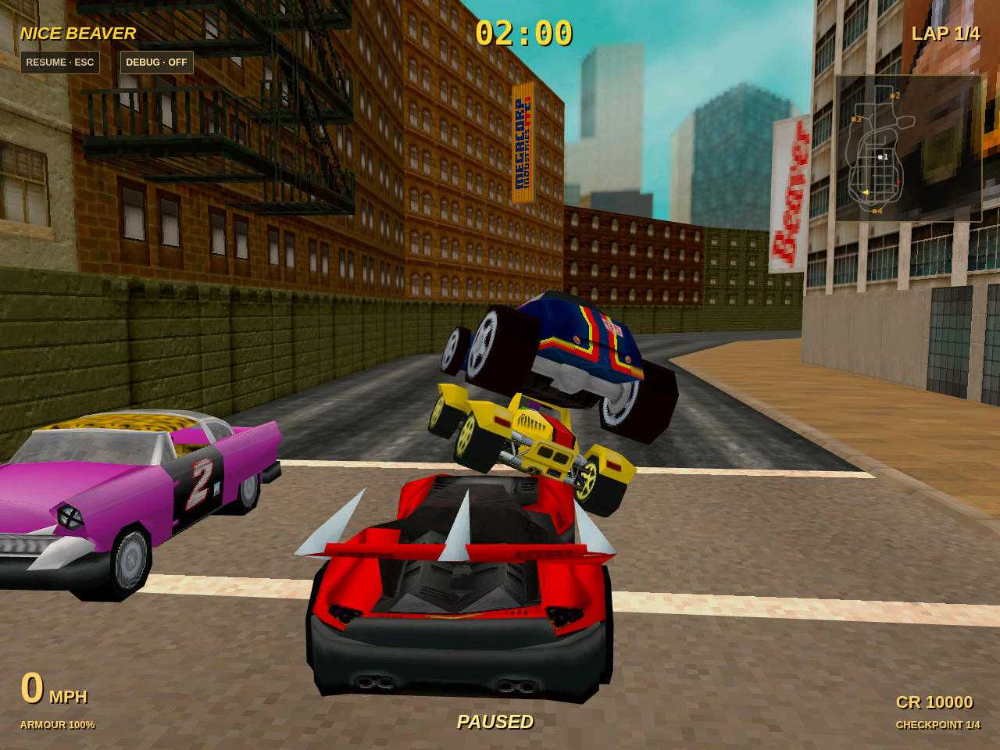

# Carmageddon II Browser Engine

## Executive Summary

This independent browser engine uses assets from a local Carmageddon II installation to render original cars, tracks, and textured pedestrians. Source-based vehicle motion, collision impulses, persistent crush, component damage, detachable parts, water, oil, noncars, lifts, world destruction, mines and recovery have numerical and Chromium checks. Original pedestrian populations, threat reactions, blood assets and WASTED lettering/sound are integrated. Game assets are read from the installation and are not included here. Remaining compatibility gaps and editable priorities are in [Backlog](backlog/README.md).

## Original vs. browser engine

Technical comparison of car geometry, body deformation and city rendering: both scenes show the same four car models and textured fire escapes. The engine scene is arranged and paused, with Eagle deformation produced by its damage system and an independently implemented HUD.

<table>
  <tr>
    <th>Original Carmageddon II</th>
    <th>Browser engine</th>
  </tr>
  <tr>
    <td></td>
    <td></td>
  </tr>
</table>

Original screenshot: [Instant Gaming](https://www.instant-gaming.com/de/16521-kaufen-carmageddon-2-carpocalypse-now-pc-steam/) (author uncredited). Game: Stainless Games; IP: THQ Nordic. Game imagery is excluded from the MIT license.

## Tech stack

- **Frontend:** TypeScript with plain HTML/CSS.
- **Rendering:** Three.js with WebGL2.
- **Audio:** Web Audio API playing original WAV assets.
- **Physics:** Custom C2 reconstruction covering vehicle motion, collision impulses, persistent crush, component damage and detachable parts.
- **Assets:** Custom parsers for original C2 files and TWT archives, with UTIF for TIFF textures; game data stays in the local installation.
- **Server and build:** Node.js and Vite, with a local asset server.
- **Tests:** Node's test runner with `tsx`, plus Playwright and Chromium for browser checks.

The engine runs directly in the browser. See [architecture notes](docs/architecture.md) for more detail.

## Task board

Tasks, evidence and priorities are maintained with [Backlog.md](backlog/README.md). Run `backlog board` for the terminal board or `backlog browser` for the editable local board. Columns are `backlog`, `next`, `wip`, `done`, sorted with priority 1 first. Original issue IDs and numeric priorities 1–5 are preserved; completed tasks remain in `done`. The `wip` column is limited to **3 actively worked-on tickets** by the project workflow; inactive partial implementations belong in `backlog`.

The deferred P5 PERF-01 umbrella retains frame-time findings after the concrete performance tickets were completed. [Scene-hierarchy preparation](docs/render-hierarchy-performance.md) avoids duplicate sky/main traversal and unseen pedestrian subtree updates. [Physics hot-path optimization](docs/physics-performance.md) now evaluates SAT axes lazily and reuses per-invocation bounds/depths while preserving numerical collision results. [Spatial body-pair discovery and shared phase geometry](docs/body-pair-performance.md) remove global pair scans and repeated transforms while preserving crash results. [Retained native MODEL bounds](docs/model-bounds-performance.md) avoid repeated raw-vertex scans for unchanged resources. [World synchronization](docs/world-sync-performance.md) retains unchanged collision geometry and prepares only query-selected native actors while preserving callback snapshots. Short hardware comparisons show lower CPU cost, with workload and cold-frame limitations documented; remaining spikes still need investigation. Resolution policy remains open. [PERF-23](docs/perf23-render-state.md) stabilizes sky/main light state to remove redundant material-program selection while preserving the extended view and pixel output. [Extended visual visibility](docs/visual-visibility.md) now presents landscape and opponents at four times authored Yon, and pedestrians at four times their original process distance, without widening native simulation activation.

[PERF-25](docs/perf25-world-joint-phase.md) removes a permanent anchored-scenery
contact cycle: the extra browser guard now permits movement against exactly
qualified native OLD contacts. Original Fridge Racer cones advance, release and
settle normally; new obstacles retain protection. The bounded original-level
replay drops from 2,400 responses to 318 over 40 ticks, without changing impulse
coefficients, retry limits or sleep thresholds. Other performance gaps remain
separately tracked.

[PHY-12](docs/guard-coupling-fix.md) corrects a trajectory-guard defect where a
nearby blocked prop could freeze a collision-free airborne car. Actual contact
and attachment constraints remain guarded; the native impulse/damage formulas
are unchanged. Terrain support traps and other crushed-hull issues remain
separately tracked.

[Smash invalidation](docs/smash-invalidation-performance.md) now distinguishes
native notifications from real collision changes. Reused unchanged tiles avoid
world rebuilds; actual changes regenerate only affected collision owners.

[World face locality](docs/world-face-performance.md) narrows static collision
and camera candidates with conservative feature bounds and stable source order.
Native wheel/face-cache semantics and uncertain or moving-owner paths retain
their existing selection; collision safeguards and simulation limits are unchanged.

[Correction-pass reuse](docs/correction-performance.md) retains validated
geometry, raw pair contacts and pure static trajectory results for unchanged
bodies. Impulses, damage, splits and world changes invalidate affected work;
native callbacks and final collision safeguards remain live. Heavy Timber tests
show fewer transformations and repeated guard queries, with mixed frame-time
results documented rather than a steady-FPS guarantee.

[Local response orchestration](docs/local-response-performance.md) now replaces
those eight global rounds with C2-informed collision rings and deferred friction.
Saved Cerby work is localized while preserving movement, joints and repair.
Whole-tick timings are mixed, including an Advanced regression; PERF-01 remains
open. [Local NONCAR participation](docs/noncar-participation-performance.md)
now keeps loaded scenery static until actual admission, rather than walking all
466 Timber props as physics bodies. Shared physical slots, retained static return
and repull preserve scenery collisions. [Hierarchy quiet ownership](docs/hierarchy-quiet-performance.md)
now connects native car/part/jointed-prop sleep and wake while retaining
physical resting debris. Grounded cars still run their original wheel-force
path. Short-session evidence and the explicit split startup correction are documented;
PERF-01 remains open.

[Atomic opponent startup](docs/opponent-startup.md) keeps partial fleets out of
physics while assets load, then validates and activates the complete grid together.
Failures and race switches dispose staged resources; genuine later crash damage
remains enabled. `npm run test:opponent-startup` checks this lifecycle with original
DUNE/Bigdump/Newhawk content.

## Run it

GitHub Actions is configured to build and run the asset-free test suite using
pinned Node/action versions and `npm ci`. Local original-data tests remain
optional; no game data is uploaded by the workflow. See
[CI setup and validation limits](docs/continuous-integration.md).

Use Node.js 20 or newer and a modern browser with WebGL support:

```sh
npm ci
npm run dev
```

Open [http://localhost:5173](http://localhost:5173). By default, the development server reads `./carma2_orig`. Set `CARMA2_ROOT` to use another local installation:

```sh
CARMA2_ROOT=/path/to/carmageddon2 npm run dev
```

For a production build, run `npm run build` and then `npm start`. The production server serves the built app and local assets on `127.0.0.1:5173`; set `PORT` to change the port.

If that port is occupied, startup reports the conflict and exits instead of
silently changing ports. Stop your previous server or use, for example,
`PORT=5174 npm run dev` (or `PORT=5174 npm start`). Invalid ports and inaccessible
asset roots also produce a concise diagnostic. Ctrl+C closes the HTTP server and
development HMR connections cleanly.

Every playtest automatically keeps a rolling **three-minute bug capture**.
Use **Save bug capture** in the upper-right corner to download a `.c2bug` file,
including from a browser started manually. Pauses preserve history. The recorder
has a **512 MiB budget**, including reserved download headroom; storage grows on
demand and byte pressure can shorten the retained window. Captures contain
physics states, contact/damage evidence and timing, not a guaranteed full-game
replay. Reloading the page clears unsaved history. See [capture contents,
inspection commands and limits](docs/bug-captures.md).

The race menu uses image tiles: choose a **location**, then an individual **race
or mission**, and a **vehicle**. Locations use the original `LOCATION` names where
available and group event variants by their authored map series. Stock and Advanced
have separate filters; searches include race/mission names and vehicle names.
Your last loaded race and vehicle are remembered locally. **Easy / Medium / Hard** selects the original skill-table column for handling damage, AI, starting upgrades/money, prices and rewards. The choice is remembered and takes effect when a race loads; changing it leaves the current race intact. Controls are available
under **Controls & engine status**; debug tools remain selectable beside Load Race. **Diagnostics** consolidates loading, compatibility and animation warnings with source/scope labels and a local JSON download.

Vehicle pictures assemble the six original menu-image fragments using the installed
interface layout. Location pictures are static views rendered from original track
geometry at the start grid. Previews are generated lazily while the menu is open,
cached for the browser session and never bundled or written into the installation.
Missing previews leave labelled, selectable tiles. Unfamiliar custom map naming
may group differently; individual events remain selectable. Run
`npm run test:selection` for the focused Stock/Advanced selection browser check.

Entries with missing track actors or player starts are shown as **Unavailable**
and cannot replace the current loaded scene. Drivable maps without supported
single-player rules, such as network arenas, are labelled **Free drive only**:
practice has no race countdown, checkpoint victory or completion payout. The same explicit fallback applies if required opponents or pedestrian actors fail during background loading; a persistent HUD/menu diagnostic explains the failure. Classic races keep their other available victory paths. See [population loading policy](docs/population-loading.md). Missions
whose goals concern opponents, pedestrians or smash targets do not require gates.
The menu checks required route data, not full mission-script compatibility or
physical access to every objective. `npm run test:race-availability` checks these
states through the normal loading path in headless Chromium.

## Drive

Choose a race and car, then select **Load Race**. The browser menus and HUD are independent implementations; the rendered game world uses original game assets.

| Key                   | Action                                      |
| --------------------- | ------------------------------------------- |
| W / Up                | Accelerate                                  |
| S / Down              | Reverse                                     |
| A / Left, D / Right   | Steer                                       |
| Shift                 | Brake                                       |
| Space                 | Handbrake                                   |
| R                     | Return to a saved safe pose for 250 credits |
| Hold E / double tap E | Repair / automatic repair using credits     |
| Tab                   | Select a charged ability                    |
| F                     | Use the selected ability                    |
| C                     | Cycle chase, cockpit, and overhead cameras  |
| + / −                 | Move the chase camera closer / farther      |
| [ / ]                 | Orbit chase camera; hold both to reset yaw  |
| M                     | Show or hide the minimap                    |
| Escape                | Pause or return to the menu                 |
| Enter                 | Skip bonus payout / restart after a race    |

Vehicle mechanics and WAM data drive suspension, tyres, steering, gears, mass/inertia, localized dents, structural bending and body splitting. Eligible MODEL actors omitted from WAM receive the native normal-softness default crush data; explicit uncrushable and GROOVE-owned parts keep their own rules. Twelve component damage units affect handling; detached parts have their own rigid state and joints. Held repair restores eligible bodywork and charges repaired component levels; split bodywork requires the full-repair pickup or reloading; wasting and its countdown persist until reloading. The ordinary physics equations are independently reconstructed from the local C2 executable; see [the evidence notes](docs/c2-physics-re.md).

The compact damage panel shows all twelve native component levels (0–99).
**Vehicle status** in the pause menu adds full component names and every active
powerup with its remaining game time or `Race`. Accepted structural bends remove
the original flag-sensitive Hot rod, Jelly suspension and Solid granite effects;
ordinary repair does not cancel them. See [status display](docs/vehicle-status.md)
and [bend-removal evidence](docs/c2-powerup-overlap-re.md).

Eligible world pickups now return using their original respawn mask and GENERAL
timing (120 seconds in both supplied installations), with the original respawn
sound and effects. Pause stops this clock; freezing only the countdown does not.
Debug/connotation grants do not respawn a world actor. The current swept-radius
collection approximation remains open under PUP-17. See
[respawn evidence and tests](docs/c2-powerup-respawn-re.md).

WAM damage tiers emit authored smash sounds and localized glass triangles. Fragment subdivision, UVs, inherited starting velocity, gravity, spin and lifetime follow installed-binary evidence. Ordinary impacts retain up to four crush events for each of eight cars until the outer physics steps finish. WAM and world texture effects share the native twenty-entry queue and flush barriers. Original Eagle3, Copcar and VLAD3 have browser impact/repair checks. Glass sources retain bounded principal-model links; held glass repair uses the shared 25-record animation with 150 ms tier steps and native repair audio. A fresh hit cancels that pane's repair animation. Vehicle effects reuse the existing abstract/ghost/physical-noncar providers and keep their own ACT frames, materials and explosion textures; the installed Stock/Advanced WAMs themselves author only sounds and glass. Deferred processing follows the installed ordinary-crush, shape, attached-flap, detachment and structural-bend order, with captured physics-tick seeds and a shared MSVC random stream. World connotations dispatch authored credit/time bonuses and nearby human-car powerup triggers through the native fifty-entry final-flush queue. Follow-up world cuboids share twenty delayed slots with noncar activations and retain live-source/captured-target context. Production followups now retain the native 400-face prefix, including generated ACT identities and pickup ACTs. Direct pickup hits share deferred powerup grants, original-ACT respawn and native mine fallback impulses. Immediate source-edge masks stay coherent with prepared model data. Fancy awards use the original SCROLLERS fonts, priorities and HUD slots. The original catalogs contain no parallel followups; that installed branch reads uninitialized scratch and remains explicitly unsupported. Ordinary pedestrian production and complete engine-wide random-consumer coverage remain separate work. See [WAM effects](docs/c2-wam-effects-re.md), [deferred crush](docs/c2-crush-queue-re.md), [attached flaps](docs/c2-flap-frame-re.md), [smash gameplay](docs/c2-smash-gameplay-re.md), [followup smashes](docs/c2-smash-followup-re.md) and [shards](docs/c2-shards-re.md).

Charged oil and authored world/WAM spills share the original 32-slot pool. Source ACT/MODEL bounds, placement delays, finite ground checks, growth, retained graphics masks and per-wheel friction/smear materials follow installed-binary evidence. `npm run test:world-slicks` checks real F/W input with Stock and Advanced plus an explicit world-connotation fixture using original resources; installed world/WAM files contain no authored slick records. Pedestrian corpse slicks and exact packed-face ordering remain separate gaps.

Original wheel forces also produce persistent tyre marks using the authored track skid material and oil-smear texture. World/car and car/car crashes share the native spark pool; original FRAG4/FRAG5 fragments use the car file’s ordered shrapnel colours. Native thresholds, local/world transformations, synchronization and lifetimes have numerical tests. WheelForces produces source-gated tyre smoke and tagged squeals; component damage selects native smoke/fire tiers using authored fire points, while newly wasted cars retain their separate fire producer. Held repair, full repair and wet volumes use distinct native lifetime controls. Audited single-player producers share their native pools and phase order. Original replacement models now start ownerless mode-zero fire at their live prepared vertices; car repair leaves that world fire running. Prepared car/noncar sources use actual retained material identities and host resource addresses, including NULL and aliases, rather than guessed material ranks. This does not claim historical Windows heap or whole-engine CRT parity. `npm run test:skidmarks` checks original city/snow/desert and oil marks; `npm run test:crash-effects` checks original car/car and city-wall effect dispatch in Chromium. See [surface effects](docs/c2-surface-effects-re.md), [sparks](docs/c2-sparks-re.md), [car/car sparks](docs/c2-car-sparks-re.md) and [shrapnel](docs/c2-shrapnel-re.md), [tyre smoke](docs/c2-tyre-smoke-re.md) and [wreck smoke](docs/c2-wreck-smoke-re.md) and [component smoke](docs/c2-component-smoke-re.md).

Recovery keeps twenty complete safe poses, using the original suspension, grip, upright and gravity checks. It restores rotation and drive state without repairing damage. Damage-triggered wasting plays the configured original explosion sound and scrolls the original font lettering; a player-caused rival wreck also shows the source reward message. See [WASTED evidence](docs/c2-wasted-re.md).

Pedestrian populations follow original race surface densities, with the native 2000-person limit. Personality/movement data drives walking, panic, running, threat prediction, turns and obstacle/floor avoidance. Original blood cloud textures, giblet models, slicks and smears are visible. Pedestrian collision/corpse motion and skeletal animation still have separate limitations: root displacement currently uses authored per-frame averages, and limbs animate procedurally. See [pedestrian evidence](docs/c2-pedestrians-re.md).

The engine also includes reconstructed opponent objectives and physical/remote path following, checkpoint/lap races, engine, impact, native pickup, checkpoint, final-lap, completion and time-expiry sounds, and original credit, repair, time, weighted random, engine and grip pickups, plus invulnerability, granite protection, damage magnification, free repairs and permanent armour/power/offense upgrades. Actions 34/35 provide charged mine/mortar and oil abilities. Mines use the GENERAL mass and timed source lifecycle; mine sphere contacts are still approximated with a sampled hull, and explosions have no radial damage. Water and oil use reconstructed source formulas. Original Gravity, Pinball, Wall Climber, soft/hard suspension and grounded timed Bounce use reconstructed native consumers and authored parameters; `npm run test:motion-powerups` checks Eagle3/Buggy suspension, real wall contacts, car/mine gravity, bounce and world/car-car Pinball behavior. Original electric rays, pedestrian annihilator/repulsion, opponent repulsion and five-slot flamethrower use reconstructed target/impulse/charge formulas. Native proximity and shared repulsion textures/visual pools are integrated; napalm has a persistent 15-second burn deadline. Its separate 25-second smoke columns, original flame textures and persistent puffs are integrated; full articulated pedestrian physics and positional sound remain open. `npm run test:combat-powerups` checks real F-key dispatch, smoke/flames and pedestrian death/credit paths. `npm run test:native-rewards` checks Drink Driving grants, original credit pickups, real-key driving and the normal stunt reward outlet. Unsupported powerup effects show an explicit notification when collected. Race catalog exclusions and no-time flags follow installed C2 behavior. Smash missions use authored runtime-variable targets; Smash-and-Ped combines selected pedestrian kills with smash events in the same signed counter. Remaining award, population and world-script gaps are documented in [race rules evidence](docs/c2-race-rules-re.md) and [Backlog](backlog/README.md).

Ordinary checkpoint credits, pedestrian base rewards/combos and waste rewards use original tables. Completion selects the authored victory-reason bonus and converts remaining time after the native finish delay; Enter skips the payout while retaining its full total. Ordered pedestrian cause/geometry classifications, native cunning-stunt rewards and signed earned-credit accounting are integrated. Drink Driving uses the original triple-credit outlet, quantized camera FOV modulation and sounds. Full-population articulated pedestrian contacts and physical cause writers remain PED-08/PED-09; see [award evidence](docs/c2-pedestrian-awards-re.md) and [Drink Driving](docs/c2-drink-driving-re.md).

The reconstructed frame clock supplies gameplay timing independently of render
FPS. Physics retains native 40 ms steps, a five-step frame budget, absolute
frame-window resynchronization and pose interpolation. Ordinary effect deadlines
and finish-payout presentation use game timestamps; timer/countdown subtraction
uses the native frame period. See [timebase evidence](docs/c2-timebase-re.md);
`npm run test:timebase` exercises real keyboard driving, active stalls and
pause/resume in Chromium.

`npm run test:wam-effects` verifies original smash sounds, glass fragments, persistent damage tiers and repair rearming. `npm run test:native-ai` checks Stock/Advanced/Snow opponent objectives, physical/remote mode transitions, freeze/thaw and player driving.

Production world queries now use the native finite collector, prepared MODEL-group order, interleaved ACT callbacks and a separate PHIL-ordered drivable wheel phase. Live smashed/grooved geometry retains original DAT provenance. Original MAT coefficients drive Gouraud/specular shading, per-material fog and texture sampling, with shared resource registries released between races. Native `OneLessPed` counts bind to existing population identities and update group/mission counters once before scoring; full native population movement remains a separate task. See [world collector evidence](docs/c2-wld-production-collector-re.md), [material rendering](docs/c2-native-material-render-re.md) and [pedestrian count integration](docs/c2-ped-native-gameplay-re.md).

Ordinary pedestrians use original FORM/MODEL definitions and BON/SKL root/bone
poses for living and death animation. ANI-01 includes source morph transitions,
head/blood model changes, shared-CRT mutant corpses, body/head visual powerups and
exact prepared-vertex fire sampling. Original arrays remain unchanged; mutable
resources are shared privately per personality. Full native population physics,
recovery and articulated/severed contacts remain PED-06/07/08/09. See
[animation evidence and ownership](docs/c2-ped-presentation-re.md).

`npm run test:ped-animation` checks original Stock/Advanced populations,
animation advance, death/Stillify, body/head/mutant powerups, parent transforms,
ordinary sweep/count/reset and race cleanup
in Chromium.

## Camera

The chase camera reads the original GENERAL projection and track far-distance
factor for native gameplay, and uses reconstructed COM tracking, zoom, reversal
and obstacle clearance. Rendering extends the authored far plane and fog range
by 4×; [visual visibility](docs/visual-visibility.md) documents the separate
opponent/pedestrian presentation and hardware measurements. Vehicle geometry retains its original scale. A documented browser
extension chooses a fitting initial zoom for large cars, within the native
0.1–2 range; Eagle retains the original 0.2 default. Zoom can then be changed
with + / −. See [camera evidence](docs/c2-camera-re.md) for verified formulas
and remaining query-order limitations.

`npm run test:camera` verifies original-car framing, projection, zoom controls,
driving, obstacle contacts, camera modes and recovery in Chromium.

## Debug mode

Enable **Debug mode** in the race menu, or click the always-visible **DEBUG · OFF** button while driving. The panel lets you freeze the race countdown (physics, opponents and timed powerups continue), add an editable amount of credits or 60 seconds, grant original powerups, refill all weapon/oil abilities, fully repair, recover for free, and restart. Optional invulnerability and free held/automatic repairs are available. F and Tab use/select granted abilities normally.

Debug mode is off on page load and stays selected across race changes within that session. Turning it off removes timer, immunity and free-repair overrides; granted credits, charges, upgrades and timed pickup effects remain. Unsupported original powerups are labelled and disabled in the list. Repair does not undo wasting: restart a wasted/finished race. Debug tools also work from the pause menu; adding time does not revive an already finished race.

## Tests

`npm run test:overlap` checks original Eagle3/Cerby driving out of embedded
released bodywork, renewed physical own-part collisions, full repair and finite
road support in the production Chromium build. See [old-overlap recovery](docs/old-overlap-recovery.md)
for native evidence, captured regressions and the deliberate guard-policy change.
Optional ignored-capture tests skip when their local snapshots are absent.

`npm run test:shallow-contact` replays the locally captured PHY-16 Timber pile
through the production simulation, including world contacts, ordinary debris
impulses, joints and repair. It skips without the private ignored capture.
See [shallow-contact diagnosis](docs/shallow-contact-recovery.md).

`npm run test:render-matrices` builds and checks real Stock/Advanced pedestrian
reactivation, matrix parity, render-pass flags and population cleanup in Chromium.

`npm run test:render-presentation` checks Stock Timber and Advanced Carrier:
pixel/matrix parity, interpolation/restoration, original scenery mutation,
reparenting and physical wake. [PERF-18](docs/render-hierarchy-performance.md#perf-18-dormant-scenery-presentation)
also avoids render-pose work for unchanged scenery. PERF-04 separately extends
[visual distances](docs/visual-visibility.md), preserving native activation.

Run `npm test` for parsers, assets and deterministic motion/contact/crush/component/structural/repair conformance, wheel rays, terrain contours, recovery history, pedestrian population/reactions/blood and WASTED tests. The real-installation tests skip when `carma2_orig` is absent. `npm run test:browser` builds the production app and runs installed Chromium when available: stock/Advanced driving and race completion, mine pickup/impact/repair, oil grip, water, Carrier lift, Airport door destruction, real-key Snow Way Out recovery, pedestrian reactions/blood and original WASTED drawing/audio dispatch. It also checks visible debug controls, timer freezing while driving, grants, ability use, repair/recovery, input isolation, disabling overrides and restarting; run `npm run test:debug` for that check alone. It additionally checks uneven-ground start grids with Eagle, Buggy and Bigdump, car-pair penetration, persistent crash deformation and real-key reverse escape on DUNE BUGGERED; run `npm run test:spawn-pairs` for that check alone. Original world pickup, actual checkpoint crossing, debug grants, ability use and expiry also have an event-audio regression; run `npm run test:event-audio` alone. Pickup/race voice selection follows the [audio evidence](docs/c2-event-audio-re.md). Player engine pitch and volume use motion RPM, special-volume indices and engine powerup state, following [verified native equations](docs/c2-engine-audio-re.md); `npm run test:engine-audio` checks stationary playback, those transforms and real keyboard driving. Screenshots and reports are saved under ignored test artifacts. `npm run test:crashes` records original-car plane/pair scenarios in ignored `artifacts/crash-conformance.json`. `npm run test:car-damage` sweeps original-stock impact/repair cases and saves an ignored diagnostic report. Small generated fixtures do not require game assets.

`npm run test:race-awards` checks original mission completion, deferred payout and Enter skip, Stock/Advanced pedestrian tables and combos, attributed rival rewards, and final-goal reward suppression in Chromium.

`npm run test:crash-earnings` drives original cars into head-on and oblique collisions in Chromium, checking native attacker selection, component damage, damage credit/time awards, persistent crush and reverse escape. See [crash earnings evidence](docs/c2-crash-earnings-re.md) for implemented equations and remaining gaps.

`npm run test:crash-matrix` checks four Stock/Advanced cars with real driving input, severe crash chains, simultaneous Eagle bumper joints, native Porker2 splitting and repair. Controlled impact setups are recorded separately from driven collisions. Reports and screenshots stay in ignored `artifacts/`.

`npm run test:grounded-split` runs the bounded original Porker2 grounded/airborne split and independent-wall browser cases, including real WAM attachments and repair. It starts its own development server and needs no production build. [PHY-17 evidence and scope](docs/grounded-split-recovery.md) distinguish this controlled reproduction from the unavailable complete historical damaged scene.

`npm run test:escaped-bodies` checks Stock Timber and Advanced Carrier escaped-prop containment and continued driving. Free props and fully detached car parts far beyond the padded authored track footprint are retired while preserving their resources and repair ownership. Fast objects inside the track and high-altitude flight remain physical. [PHY-18](docs/timber-runaway-props.md) records the bounded-work fix and the still-unresolved initial excessive-energy impulse tracked by PHY-19.

`npm run test:ped-gameplay` checks the native pedestrian resource/contact adapter
in Stock and Advanced Chromium: keyboard-driven Eagle contact, original death
models, attribution and count/score callbacks; a separately labeled controlled
contact checks actual severing and independent PHIL registration. Inactive
resource release is covered. Active-corpse recovery/release still requires its
remaining source effect outlets, and normal populations retain the existing
movement/contact path. The report distinguishes these unresolved paths; it does
not claim full native population integration.

`npm run test:component-smoke` drives original Eagle/Buggy collisions and checks
component smoke, wasting order and held/full repair. Its report distinguishes
unreached smoke tiers. `npm run test:ghosts` checks original Stock/Advanced
Newcity and Airport ghost fragments, borrowed ACT geometry/textures, motion,
group expiry and material replacement. These ghost contacts are controlled
fixtures, separately labelled from driven crashes. `npm run test:noncar-debris`
checks authored Stock/Advanced city pump and Carrier gun debris: original
mechanics, collision hulls, physical motion, fire columns and race cleanup.
`npm run test:noncar-quiet` additionally checks controlled original free-body drops reaching
source contact-ring sleep and registered wake/static repull with real car-body
impulses. Authored launch snapshots remain separate; the previous city station
ledge fixture is not proof of unobstructed velocity exchange. `npm run test:noncar-participation` checks original Stock/Advanced
static approaches and retained-ACT reclaim/repull. Local slot admission and
free-prop reclaim and supported jointed hierarchy quiet state are integrated.
`npm run test:hierarchy-quiet` checks original Eagle/Cerby settling, retained
parts, actual impact wake, force-work resumption, repair and controlled airborne
split startup. Native pool-memory aliasing, tumble eligibility and
historical Windows material-address capture still have documented gaps. Live positive-material preparation uses owned host resource addresses. See [wake and repull evidence](docs/c2-noncar-wake-pull-re.md).

`npm run test:world-effects` checks original Stock/Advanced city and Carrier replacement fire, actual MODEL/ACT ownership, same-model rejection, unrelated car repair, fancy award dispatch and the full Carrier objective/followup chain. Controlled prop contacts and synthetic nonzero fancy awards are labelled separately from driven crashes. See [producer coverage](docs/c2-effect-producer-audit.md), [replacement fire](docs/c2-replacement-fire-re.md), [source edges and collector](docs/c2-world-smash-source-edges-re.md) and [pickup ACT hits](docs/c2-pickup-act-re.md).

## Asset and license notes

Use an installation you are entitled to use. Assets are read from that directory at runtime and are not copied into this repository or included in its license. Independently written project code is MIT licensed; see [LICENSE](LICENSE). The runtime depends on Three.js (MIT), UTIF (MIT), and UTIF's dependency pako (MIT and Zlib). UTIF also embeds a PDF.js/jpgjs JPEG decoder (Apache-2.0). Their copyright notices and license texts are included in [THIRD_PARTY_LICENSES.txt](THIRD_PARTY_LICENSES.txt).

Every production build includes `LICENSE.txt` and `THIRD_PARTY_LICENSES.txt` at the root of `dist/`. Keep both files with distributed builds. Update the third-party notices when upgrading bundled dependencies.

Format research consulted rec2, dethrace, OpenC1, and ToxicRagers. No source code from those projects is included or used as a runtime dependency. Their licenses do not apply to this independent implementation, and this project's license grants no rights to Carmageddon II game data.
