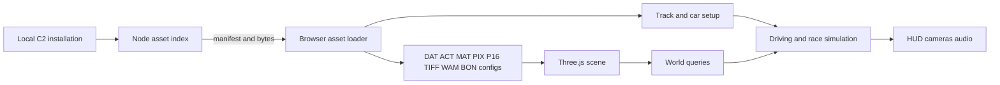

# Architecture

## Executive Summary

The Node service indexes a local game installation and exposes files and TWT archive entries to the browser. TypeScript readers decode original assets, Three.js assembles the scene, and separate browser systems provide driving, damage, races, pedestrians, and interface behavior. Original scene assets are reused; the game engine itself is independently implemented.

## Implementation choice

A short source review compared a browser engine with a WebAssembly adaptation. rec2 reconstructs C2 in C and has a native SDL path, but still contains unimplemented behavior; no ready browser target was found. Dethrace and OpenC1 target the first game. A native TypeScript/WebGL2 engine offered the quickest route from this installation to a playable scene. The references informed formats and behavior, without incorporating their source.

Car handling uses source dimensions, mass, wheelbase, acceleration and speed limits, with a 6.9-metre world-unit conversion informed by reconstruction references. The bicycle steering model, lateral grip, collision response and low-gear acceleration adjustment are approximations. These are isolated in `src/gameplay.ts` and `src/handling.ts` for replacement as behavior is reconstructed.

## Asset service and loading

`server/assets.mjs` indexes loose files and virtual paths for entries in `.TWT` archives. Loose files take precedence over archive entries with the same path. Reads are confined to the selected installation root. `server/dev.mjs` serves the manifest and file bytes to the browser; it does not expose direct filesystem access. Set `CARMA2_ROOT` to select an installation. Otherwise the server looks for `carma2_orig` in the current working directory and listens on loopback.

`src/formats.ts` decodes supported binary and text formats. `src/config.ts` reads track, car, race-catalog, and opponent configuration. `src/content.ts` resolves textures, builds geometry and materials, and assembles ACT hierarchies. Pixelmaps and TIFF textures are supported, as are WAM deformation metadata and BON/SKL motion data parsing. The app uses Three.js for display and UTIF for TIFF decoding.

## Runtime

At startup, the browser discovers race and car configurations. Loading a race creates its scene and collision queries from rendered triangles, then initializes the car using the selected config. Track nodes drive up to four simplified graph-following opponents. Race logic reads available gates, laps, timer values, and rewards. Victory can follow the configured lap goal, eliminating all opponents, or eliminating pedestrians, where the selected objective supports it. Mission behavior is approximated and unsupported objectives use a free-driving label.

Vehicle damage uses bounded per-part deformation, crush planes, hinge vertices, and configured smash thresholds, with repair restoring the car. Pedestrians use original textured models and simple generated limb motion and flee/hit behavior; parsed BON/SKL motion is not played back. Audio covers engine, impact, checkpoint, and gesture-unlock cues. Placed original power-up actors provide credit, repair, time, and engine effects from their source definitions. Funk/groove support is partial, including rolling, steering, brake-light atlas changes, water, and fan effects. Suspension remains static, while a full drivetrain/tire solver is not implemented.

## Main modules

| File                 | Responsibility                                                          |
| -------------------- | ----------------------------------------------------------------------- |
| `server/assets.mjs`  | TWT indexing, root-confined reads, and virtual archive paths            |
| `src/formats.ts`     | Binary, texture, and encoded-text readers                               |
| `src/config.ts`      | Track, car, race-catalog, and opponent config parsing                   |
| `src/content.ts`     | Texture, material, geometry, and actor scene assembly                   |
| `src/world.ts`       | Ground, wall, and world-space queries                                   |
| `src/gameplay.ts`    | Driving, damage, repairs, recovery, and race state                      |
| `src/powerups.ts`    | Source power-up definitions, pickup actors, awards, and timed modifiers |
| `src/ai.ts`          | Road graph navigation and opponent steering                             |
| `src/damage.ts`      | WAM-guided vehicle deformation and repair                               |
| `src/pedestrians.ts` | Original pedestrian models, simple motion, fleeing, and hits            |
| `src/animation.ts`   | Supported FUNK/GROOVE model and texture animation                       |
| `src/audio.ts`       | Original WAV engine loops and event sounds                              |
| `src/main.ts`        | Startup, input, menus, cameras, HUD, opponents, pedestrians, and audio  |
