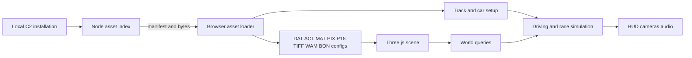

# Architecture

## Executive Summary

The Node service indexes a local game installation and exposes files and TWT archive entries to the browser. TypeScript readers decode original assets, Three.js assembles the scene, and separate browser systems provide driving, damage, races, pedestrians, and interface behavior. Original scene assets are reused; the game engine itself is independently implemented.

## Implementation choice

A short source review compared a browser engine with a WebAssembly adaptation. rec2 reconstructs C2 in C and has a native SDL path, but still contains unimplemented behavior; no ready browser target was found. Dethrace and OpenC1 target the first game. A native TypeScript/WebGL2 engine offered the quickest route from this installation to a playable scene. The references informed formats and behavior, without incorporating their source.

Vehicle simulation lives in `src/physics/` and runs at the original 40 ms tick with at most five catch-up steps. Authored car mechanics feed four-wheel spring/damper loads, tyre force limits, steering, gears, mass and diagonal inertia. Moving-feature contacts and joints share a connected-group impulse solve. Its pre-impulse callback feeds C2 damage/crush and invalidates/recollects contacts when a car splits. Three.js supplies rendering; hull topology and vehicle simulation are independent implementations verified against the installed C2 executable. `src/gameplay.ts` retains race state and legacy handling helpers; the browser drives through `VehicleSimulation`.

`src/render-pose.ts` interpolates committed car and physical-part poses between ticks, including camera targets. Recovery invalidates the previous pose. Rendered transforms are restored immediately after drawing, so interpolation never changes collision, damage, attachment or race state.

After collision impulses change a trajectory, a bounded integration guard checks its new translation and sampled angular path against actual finite world triangles. Newly encountered surfaces use the existing contact/damage solver. A remaining crossing stops at its time of contact. This browser safety extension closes post-impact floor tunnelling; it is separate from the reconstructed original contact-selection rules and does not invent an infinite floor.

## Asset service and loading

`server/assets.mjs` indexes loose files and virtual paths for entries in `.TWT` archives. Loose files take precedence over archive entries with the same path. Reads are confined to the selected installation root. `server/dev.mjs` serves the manifest and file bytes to the browser; it does not expose direct filesystem access. Set `CARMA2_ROOT` to select an installation. Otherwise the server looks for `carma2_orig` in the current working directory and listens on loopback.

`src/formats.ts` decodes supported binary and text formats. `src/config.ts` reads track, car, race-catalog, and opponent configuration. `src/content.ts` resolves textures, builds geometry and materials, and assembles ACT hierarchies. Pixelmaps and TIFF textures are supported, as are WAM deformation metadata and BON/SKL motion data parsing. The app uses Three.js for display and UTIF for TIFF decoding.

## Runtime

At startup, the browser discovers race and car configurations. Loading a race creates its scene and collision queries from rendered triangles, then initializes the car using the selected config. Track nodes drive up to four simplified graph-following opponents. Race logic reads available gates, laps, timer values, and rewards. Victory can follow the configured lap goal, eliminating all opponents, or eliminating pedestrians, where the selected objective supports it. Mission behavior is approximated and unsupported objectives use a free-driving label.

Vehicle damage applies original WAM eligibility planes, per-part softness, cumulative localized crush, structural bending and splitting, twelve component programs, and persistent detachable parts. Render normals retain DAT smoothing masks; collision shape changes follow their separate source rules. Incremental and full repair restore the appropriate geometry, component and attachment state. Pedestrians use original textured models and simple generated limb motion and flee/hit behavior; parsed BON/SKL motion is not played back. Audio covers engine, impact, checkpoint, and gesture-unlock cues. Placed original power-up actors provide credit, repair, time, engine/grip, invulnerability, damage/protection, free-repair and permanent APO effects from their source definitions. Funk/groove support is partial, including rolling, steering, brake-light atlas changes, water, and fan effects. Source suspension lengths, wheel RPM and damage tilt feed animation; damage tilt feeds back into tyre contact.

## Main modules

| File                        | Responsibility                                                                            |
| --------------------------- | ----------------------------------------------------------------------------------------- |
| `server/assets.mjs`         | TWT indexing, root-confined reads, and virtual archive paths                              |
| `src/formats.ts`            | Binary, texture, and encoded-text readers                                                 |
| `src/config.ts`             | Track, car, race-catalog, and opponent config parsing                                     |
| `src/selection-catalog.ts`  | Source-scoped map-series grouping and location/objective labels for race selection        |
| `src/selection-menu.ts`     | Searchable location, event and vehicle tiles backed by the existing load selection        |
| `src/selection-previews.ts` | Original menu fragment composition and disposable static track preview rendering          |
| `src/content.ts`            | Texture, material, geometry, and actor scene assembly                                     |
| `src/render-pose.ts`        | Physics-pose interpolation for rendering and camera targets                               |
| `src/world.ts`              | Ground, wall, and world-space queries                                                     |
| `src/gameplay.ts`           | Race state, recovery and retained legacy handling helpers                                 |
| `src/physics/`              | Source motion, contact groups, joints, crush, components, structural splitting and repair |
| `src/powerups.ts`           | Source power-up definitions, pickup actors, awards, and timed modifiers                   |
| `src/ai.ts`                 | Road graph navigation and opponent steering                                               |
| `src/damage.ts`             | WAM-guided vehicle deformation and repair                                                 |
| `src/pedestrians.ts`        | Original pedestrian models, simple motion, fleeing, and hits                              |
| `src/animation.ts`          | Supported FUNK/GROOVE model and texture animation                                         |
| `src/audio.ts`              | Original WAV engine loops and event sounds                                                |
| `src/main.ts`               | Startup, input, menus, cameras, HUD, opponents, pedestrians, and audio                    |
